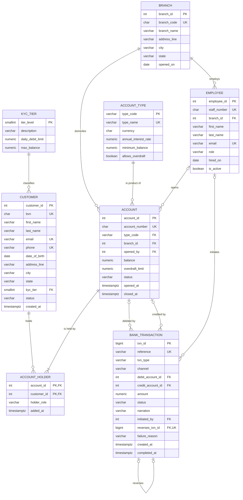

# Portfolio 1 – Database Design and Modelling

- **Case study:** OwoTrust Digital Bank (simulated Nigerian retail bank / fintech)
- **DBMS:** PostgreSQL 16 (Docker)

| File | Purpose |
|---|---|
| [sql/01_schema.sql](sql/01_schema.sql) | Creates the 8 tables with all keys and constraints |
| [sql/02_seed_data.sql](sql/02_seed_data.sql) | Realistic sample data (15 customers, 20 accounts, 52 transactions) |
| [sql/03_constraint_tests.sql](sql/03_constraint_tests.sql) | 20 negative tests + 1 positive test proving the constraints work |
| [sql/04_verify.sql](sql/04_verify.sql) | Structural checks, balance audit and sample joins |
| [run_all.sh](run_all.sh) | Rebuilds everything and regenerates the evidence files |
| [evidence/](evidence/) | Captured output of every script |

---

## 1. Case study

**OwoTrust Digital Bank** is a simulated Nigerian retail bank. It has five branches (Lagos Island, Ikeja, Abuja, Ibadan and Port Harcourt) and a mobile app. Customers open savings, current and USD domiciliary accounts, either in a branch or on the app. They move money through branch tellers, the mobile app, web, USSD, ATM and POS channels.

**Database users**

| User | What they do with the data |
|---|---|
| Customers (via mobile/web/USSD) | View balances and statements, transfer funds |
| Tellers | Post cash deposits and withdrawals over the counter |
| Customer-service staff / branch managers | Open and close accounts, add joint holders, approve reversals |
| Compliance officers | Monitor KYC tiers, freeze accounts, review flagged transactions |
| Auditors | Read-only access; reconcile stored balances against transaction history |
| System (batch jobs) | Charge monthly fees, post interest |

**Major data stored:** customers (BVN, contact details, KYC tier), branches, staff, account products, accounts, account ownership (including joint accounts), and every money movement with its status.

**Key operations:** open an account, deposit, withdraw, transfer funds, reverse a failed or mistaken transaction, charge fees, generate an account statement, and audit account balances.

---

## 2. ER diagram



*(GitHub renders this diagram automatically. Notation: crow's foot. `||` = exactly one, `|o` = zero or one, `o{` = zero or many, `|{` = one or many.)*

**Relationships in words**

- A **customer** belongs to exactly one **KYC tier**, which sets their daily debit limit and maximum balance.
- **Customer ↔ account is many-to-many.** One customer can hold several accounts, and a joint account has several holders. The associative entity **ACCOUNT_HOLDER** resolves this, with a `holder_role` of PRIMARY or JOINT.
- Every **account** is one **account type** (a product) and is domiciled at one **branch**. It may have been opened by an **employee**; if it was opened on the app, there is none.
- A **bank transaction** debits zero or one account and credits zero or one account. Which side is required depends on the transaction type.
- A **reversal** is itself a transaction that points back to the one transaction it reverses (a recursive 1:0..1 relationship).

---

## 3. Relational schema

Notation: **bold** = primary key, *italic* = foreign key (→ referenced table), UK = unique (candidate key).

```
KYC_TIER        (tier_level, description, daily_debit_limit, max_balance)
BRANCH          (branch_id, branch_code UK, branch_name, address_line, city, state, opened_on)
EMPLOYEE        (employee_id, staff_number UK, branch_id→BRANCH, first_name, last_name,
                 email UK, role, hired_on, is_active)
CUSTOMER        (customer_id, bvn UK, first_name, last_name, email UK, phone UK, date_of_birth,
                 address_line, city, state, kyc_tier→KYC_TIER, status, created_at)
ACCOUNT_TYPE    (type_code, type_name UK, currency, annual_interest_rate, minimum_balance,
                 allows_overdraft)
ACCOUNT         (account_id, account_number UK, type_code→ACCOUNT_TYPE, branch_id→BRANCH,
                 opened_by→EMPLOYEE, balance, overdraft_limit, status, opened_at, closed_at)
ACCOUNT_HOLDER  (account_id→ACCOUNT, customer_id→CUSTOMER, holder_role, added_at)
                 PK = (account_id, customer_id)
BANK_TRANSACTION(txn_id, reference UK, txn_type, channel, debit_account_id→ACCOUNT,
                 credit_account_id→ACCOUNT, amount, status, narration, initiated_by→EMPLOYEE,
                 reverses_txn_id→BANK_TRANSACTION UK, failure_reason, created_at, completed_at)
```

The first attribute of each relation is its primary key, except `ACCOUNT_HOLDER`, which has a composite key. The full DDL is in [sql/01_schema.sql](sql/01_schema.sql).

### 3.1 Key choices

| Decision | Reason |
|---|---|
| **Surrogate identity keys** (`customer_id`, `account_id`, …) | Natural identifiers change (phone, e-mail) or are sensitive. A BVN is personal data, so it should not be copied into every child table as a foreign key. Integer keys also keep joins and indexes small. |
| **Natural keys kept as `UNIQUE`** (`bvn`, `phone`, `account_number`, `reference`, `staff_number`, `branch_code`) | They are still candidate keys and must not be duplicated. |
| **Natural PK for lookup tables** (`account_type.type_code`, `kyc_tier.tier_level`) | These codes are short, stable and meaningful, so a surrogate would add nothing. |
| **Composite PK on `account_holder`** | The pair (account, customer) identifies a holding. It also stops the same customer being added twice to one account. |
| `GENERATED ALWAYS AS IDENTITY` instead of `SERIAL` | This is the SQL-standard form. It also stops applications from accidentally supplying their own IDs. |
| **No `ON DELETE CASCADE`** | Financial records must never disappear as a side effect. Accounts are *closed* and transactions are *reversed*; neither is deleted (see tests T19–T20). |

### 3.2 Data-type choices

- **`NUMERIC(18,2)` for money.** It stores exact decimals. `FLOAT` would introduce rounding errors (e.g. 0.1 + 0.2 ≠ 0.3).
- **`TIMESTAMPTZ` for every event time.** It stores an absolute instant, so channels in different time zones still compare correctly. The seed uses Africa/Lagos time (+01).
- **`CHAR(10)` for account numbers and `CHAR(11)` for BVNs.** Both are fixed length, and a regex `CHECK` ensures they contain digits only.

### 3.3 Constraints → business rules

| Constraint | Business rule it enforces |
|---|---|
| `customer_bvn_check`, `customer_phone_check`, `account_account_number_check` | BVN is 11 digits; phone is `+234` + 10 digits; NUBAN account number is 10 digits |
| `chk_account_balance_floor` (`balance >= -overdraft_limit`) | An account can go negative only as far as its approved overdraft. Savings accounts have a limit of 0, so they can never go negative. |
| `chk_account_closed_state`, `chk_account_close_order` | `closed_at` is set if and only if the account is CLOSED, and it cannot be earlier than `opened_at` |
| `uq_account_single_primary_holder` (partial unique index) | An account has at most one PRIMARY holder but can have any number of JOINT holders |
| `chk_txn_legs` | DEPOSIT credits only; WITHDRAWAL/FEE debit only; TRANSFER has both sides; REVERSAL has at least one |
| `chk_txn_distinct_accounts` | Money cannot be transferred to the same account |
| `chk_txn_reversal_link` + `UNIQUE(reverses_txn_id)` | A reversal must name the transaction it reverses, and a transaction can be reversed **only once** |
| `chk_txn_completed_at`, `chk_txn_completed_order` | A completion time exists exactly when money has moved, and it cannot be earlier than the creation time |
| `chk_txn_failure_reason` | A FAILED transaction must record why it failed |
| `chk_txn_branch_teller` | Over-the-counter (BRANCH) transactions must record the teller |
| `UNIQUE(reference)` | Each transaction reference is unique. This makes it an idempotency key: a retried request cannot post twice. |

### 3.4 Rules that cannot be declared as constraints

The rules below span several rows or tables, so a `CHECK` constraint cannot express them. They will be enforced in **Portfolio 3** inside transactions, stored procedures and triggers:

1. A debit must not exceed the customer's **KYC daily limit**, which needs a sum over the day's transactions.
2. Every account must have **at least one** PRIMARY holder. This is a cross-table, "at least one" rule.
3. `overdraft_limit > 0` is only allowed when `account_type.allows_overdraft` is TRUE.
4. Both sides of a transfer must be accounts with the **same currency** (FX is out of scope).
5. No new postings to **FROZEN or CLOSED** accounts.
6. `account.balance` must always equal the sum of posted transactions (see §4.5).

---

## 4. Normalisation

### 4.1 Starting point: unnormalised form (UNF)

Before a database, a branch might keep an "account register" spreadsheet with **one row per account** and repeating groups for holders and transactions:

```
ACCOUNT_REGISTER( account_number, type_code, type_name, currency, interest_rate,
                  branch_code, branch_name, branch_city, branch_state, balance,
                  { bvn, holder_name, phone, kyc_tier, tier_daily_limit, holder_role },      ← repeating group
                  { reference, txn_date, txn_type, amount, status, debit_account,
                    credit_account, teller_staff_no, teller_name } )                         ← repeating group
```

The joint account 3010000004, for example, would need two holders and many transactions crammed into a single cell each.

### 4.2 First normal form (1NF): atomic values, no repeating groups

The repeating groups are flattened so every cell holds one value. Each row now represents one *(account, holder, transaction)* combination, and the key becomes **{account_number, bvn, reference}**.

This is now in 1NF, but it has heavy redundancy and three kinds of anomaly:

- **Update anomaly:** renaming the Ikeja branch means changing every row for every account at that branch. Missing one leaves the data inconsistent.
- **Insertion anomaly:** a new branch or product cannot be recorded until an account with a transaction exists.
- **Deletion anomaly:** deleting an account's only transaction also deletes the only record of the account's product and branch.

### 4.3 Second normal form (2NF): remove partial dependencies

Several attributes depend on only *part* of the composite key:

| Functional dependency | Depends on |
|---|---|
| account_number → type_code, type_name, currency, interest_rate, branch_code, branch_name, branch_city, branch_state, balance | part of key |
| bvn → holder_name, phone, kyc_tier, tier_daily_limit | part of key |
| reference → txn_date, txn_type, amount, status, debit_account, credit_account, teller_staff_no, teller_name | part of key |
| {account_number, bvn} → holder_role | part of key |

Decomposing on these dependencies gives four relations, each with no partial dependency:

```
ACCOUNT_2NF     (account_number, type_code, type_name, currency, interest_rate,
                 branch_code, branch_name, branch_city, branch_state, balance)
CUSTOMER_2NF    (bvn, holder_name, phone, kyc_tier, tier_daily_limit)
ACCOUNT_HOLDER  (account_number, bvn, holder_role)
TRANSACTION_2NF (reference, txn_date, txn_type, amount, status, debit_account,
                 credit_account, teller_staff_no, teller_name)
```

### 4.4 Third normal form (3NF): remove transitive dependencies

Some non-key attributes still depend on other non-key attributes:

| Transitive dependency | New relation |
|---|---|
| account_number → type_code → type_name, currency, interest_rate | **ACCOUNT_TYPE**(type_code, …) |
| account_number → branch_code → branch_name, branch_city, branch_state | **BRANCH**(branch_code, …) |
| bvn → kyc_tier → tier_daily_limit | **KYC_TIER**(tier_level, …) |
| reference → teller_staff_no → teller_name | **EMPLOYEE**(staff_number, …) |

After this step, `currency` is no longer stored on the account. It is reached through `type_code`, because currency depends on the product rather than the individual account.

Finally, surrogate keys replace the natural keys as primary keys (§3.1), and the natural keys stay as `UNIQUE` constraints. The result is the eight tables in §3.

### 4.5 BCNF check

A relation is in **Boyce–Codd normal form** if every non-trivial functional dependency X → Y has X as a candidate key. Every determinant in the final schema is a candidate key:

- `customer`: customer_id, bvn, phone and email are all candidate keys.
- `account`: account_id and account_number.
- `bank_transaction`: txn_id and reference. (`reverses_txn_id` is unique where it is not null.)
- `employee`: employee_id, staff_number and email.
- `branch`: branch_id and branch_code.
- `account_holder`: (account_id, customer_id).
- `account_type`: type_code and type_name.
- `kyc_tier`: tier_level.

The schema is therefore in **BCNF**.

*Note on addresses:* `city → state` is **not** a functional dependency in Nigeria, because some place names occur in more than one state (for example, Surulere is in both Lagos and Oyo). The address fields therefore stay in `customer` and `branch` and are treated as part of the address.

### 4.6 Controlled denormalisation: `account.balance`

`balance` is technically **derived data**: it equals Σ credits − Σ debits over the account's posted transactions. A fully normalised design would not store it. It is kept deliberately because:

- Authorising a withdrawal or transfer needs the balance **immediately**. Summing a history that grows to millions of rows (Portfolio 2) on every debit would be too slow.
- The `CHECK (balance >= -overdraft_limit)` constraint can then stop overdrawing at the database level.

The cost is a risk of inconsistency, which is managed in two ways:

1. In Portfolio 3, the balance is updated **in the same ACID transaction** that inserts the `bank_transaction` row.
2. The audit query in [04_verify.sql](sql/04_verify.sql) (section 5) recomputes every balance and lists any mismatch. It currently returns **0 rows**.

### 4.7 Design alternative considered

An alternative design would put money movements in a separate `ledger_entry` table, with one row per debit or credit leg (double-entry style). I chose **debit_account_id / credit_account_id columns on one row** instead, because every rule about which side a transaction must have can then be declared as a `CHECK` constraint (`chk_txn_legs`, `chk_txn_distinct_accounts`). A separate ledger table would need triggers to keep debits and credits balanced.

The trade-off is that an account statement must search **two** columns (`WHERE debit_account_id = X OR credit_account_id = X`). That query becomes a target for optimisation in Portfolio 2.

---

## 5. How to run and test

```bash
# from the repository root
docker compose up -d                          # start PostgreSQL 16 on localhost:5433
./portfolio-1-database-design/run_all.sh      # build schema, load data, run tests, save evidence
```

To explore the data interactively:

```bash
docker exec -it owotrust-pg psql -U owotrust -d owotrust_bank
```

### Test results ([evidence/03_constraint_tests_output.txt](evidence/03_constraint_tests_output.txt))

All tests run inside a single transaction that is rolled back at the end, so the seed data is never changed.

| # | Attempted change | Expected | Result |
|---|---|---|---|
| T01 | Duplicate BVN | unique violation | ✅ rejected |
| T02 | 7-digit BVN | check violation | ✅ rejected |
| T03 | Phone `0803…` (not +234) | check violation | ✅ rejected |
| T04 | KYC tier 4 | FK violation | ✅ rejected |
| T05 | Unknown account product | FK violation | ✅ rejected |
| T06 | Savings balance −1 | `chk_account_balance_floor` | ✅ rejected |
| T07 | Current account past its ₦100,000 overdraft | `chk_account_balance_floor` | ✅ rejected |
| T08 | CLOSED status with no `closed_at` | `chk_account_closed_state` | ✅ rejected |
| T09 | Second PRIMARY holder | partial unique index | ✅ rejected |
| T10 | Transfer to the same account | `chk_txn_distinct_accounts` | ✅ rejected |
| T11 | Deposit that also debits | `chk_txn_legs` | ✅ rejected |
| T12 | Negative amount | check violation | ✅ rejected |
| T13 | Reversal with no link to the original | `chk_txn_reversal_link` | ✅ rejected |
| T14 | Reversing a transaction twice | unique violation | ✅ rejected |
| T15 | FAILED with no reason | `chk_txn_failure_reason` | ✅ rejected |
| T16 | COMPLETED with no `completed_at` | `chk_txn_completed_at` | ✅ rejected |
| T17 | Branch deposit with no teller | `chk_txn_branch_teller` | ✅ rejected |
| T18 | Duplicate transaction reference | unique violation | ✅ rejected |
| T19 | Delete a customer who holds accounts | FK violation | ✅ rejected |
| T20 | Delete an account that is still referenced | FK violation | ✅ rejected |
| T21 | **Valid** pending transfer | success | ✅ `INSERT 0 1` |

### Verification ([evidence/04_verify_output.txt](evidence/04_verify_output.txt))

- 8 tables and 61 declared constraints (PK, UNIQUE, FK, CHECK), plus one partial unique index.
- The **balance audit returns 0 mismatches**: every stored balance equals the balance derived from transaction history.
- The sample data covers a joint account, two USD domiciliary accounts, an overdraft drawdown (3010000002 went to −₦50,050 before being topped up), a frozen account, a closed account, two failed transfers, one pending transfer and one reversal pair.
