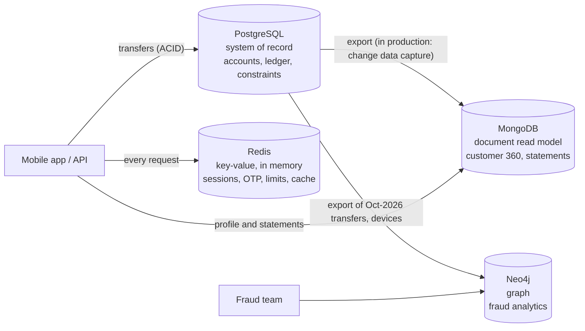

# Portfolio 4 – NoSQL and Advanced Data Models

- **Case study:** OwoTrust Digital Bank. This is the **same data** as Portfolios 1–3: 50,020 customers, 60,025 accounts and about 1.06 million transactions, generated by Portfolio 2's script.
- **Databases:**
  - **MongoDB 7.0** (document)
  - **Redis 7.4** (key-value)
  - **Neo4j 5.26** (graph)
  - PostgreSQL 16 as the system of record

A real bank does not replace its relational ledger with NoSQL. It adds NoSQL stores **beside** the ledger, each for the workload it suits best. This is called *polyglot persistence*. This portfolio builds that architecture and checks it for consistency:



| File | Purpose |
|---|---|
| [source/01_prepare_source_data.sql](source/01_prepare_source_data.sql) | Adds device fingerprints and a hidden money-mule fraud ring to the PostgreSQL data |
| [source/02_export_customers.sql](source/02_export_customers.sql), [source/03_export_statements.sql](source/03_export_statements.sql) | Relational rows → MongoDB documents, built with PostgreSQL's JSON functions |
| [source/graph/](source/graph/) | Relational rows → CSV files for the Neo4j graph |
| [mongodb/](mongodb/) | Validated collections, queries and indexes, multi-document transactions |
| [redis/redis_demo.sh](redis/redis_demo.sh) | Sessions, OTP, rate limiting, idempotency, leaderboard, cache, benchmark |
| [neo4j/](neo4j/) | Graph load and five fraud-detection queries |
| [source/04_postgres_comparison.sql](source/04_postgres_comparison.sql) | The same questions answered by PostgreSQL, for a fair comparison |
| [run_all.sh](run_all.sh) | Rebuilds everything and regenerates `evidence/` (~1 min) |
| [evidence/](evidence/) | All outputs, sample documents and automatic cross-checks |

---

## 1. Source data and export

1. **Base data.** [01_prepare_source_data.sql](source/01_prepare_source_data.sql) starts from the Portfolio 2 dataset and adds two things:
   - **`customer_device`:** 65,033 device sightings. Most customers have 1–2 private devices, and one family of 3 shares a tablet.
   - **A money-mule fraud ring,** hidden among roughly 32,000 normal October transfers:
     - two scam victims pay "investment" money into newly opened Tier-1 accounts
     - the money hops mule1 → mule2 → mule3 → mule4, loops back to mule1, and is withdrawn at ATMs by mule5
     - all 5 mule accounts were registered from **the same phone**
2. **Export.** PostgreSQL builds the documents itself (`json_build_object`, `json_agg`), so the relational-to-document mapping is visible in SQL. Money is exported as `{"$numberDecimal": …}` and dates as `{"$date": …}` (MongoDB Extended JSON), so **no precision is lost** going from `NUMERIC(18,2)` to `Decimal128`.

| Export | Rows / documents | Size |
|---|---:|---:|
| `customers.ndjson` | 50,020 | 49 MB |
| `statements.ndjson` | 132,386 | 112 MB |
| Graph CSVs: customers, accounts, devices, transfers, cash-outs | 214,212 | 11 MB |

The exports are regenerated by `run_all.sh` and kept out of Git (`.gitignore`). Pretty-printed samples are in [evidence/sample_customer_document.json](evidence/sample_customer_document.json) and [evidence/sample_statement_document.json](evidence/sample_statement_document.json).

---

## 2. Document model: MongoDB

### 2.1 Design decisions

| Data | Decision | Reason |
|---|---|---|
| Customer + contact + address | **One document per customer** | The app's home screen needs all of it in one read. In PostgreSQL this is a **7-table join** (customer, kyc_tier, account_holder, account, account_type, branch, customer_device). |
| KYC documents | **Embedded array, items of DIFFERENT shapes** | A NIN has `number`/`verifiedAt`, a utility bill has `issuer`/`addressMatched`, a passport has `expiresOn`. Tier 1 has none, tier 3 has three. Relationally this needs a sparse table full of NULLs, or one table per document type. |
| Accounts | **Embedded summaries** (extended reference pattern) | They are shown with the customer. The cost is that `balance` is now **duplicated**, so this collection is a *read model* refreshed from PostgreSQL, never the ledger. |
| Devices | **Embedded array** | Owned by the customer, small, and read together with it. |
| Statements | **Separate collection, one document per account per month** (bucket pattern) | A statement becomes one read by `_id`. The month boundary **bounds** the array (the validator enforces `maxItems: 2000`), so documents cannot grow without limit. |
| Individual transactions | **Not** stored as their own documents | The ledger stays in PostgreSQL, where Portfolio 3 proved it correct under concurrency. |

The resulting customer document (abridged, from [04_mongodb_queries.txt](evidence/04_mongodb_queries.txt)):

```js
{ _id: 1015, bvn: '22200001000', name: { first: 'Hauwa', last: 'Okonkwo' },
  contact: { phone: '+2348100001000', email: 'hauwa.okonkwo1000@example.com' },
  kyc: { tier: 2, dailyDebitLimit: Decimal128('200000.00'), verifiedBy: ['BVN','PHONE','NIN'],
         documents: [ { type: 'NIN', number: '70000001015', verifiedAt: ISODate(...) } ] },
  accounts: [ { accountNumber: '3100001000', product: 'SAV_NGN', balance: Decimal128('107100.00'),
                branch: { code: '001', name: 'Lagos Island Main' }, ... },
              { accountNumber: '3100051000', ... } ],
  devices: [ { deviceId: 'dev-694cac15d72d', platform: 'ANDROID', firstSeen: ISODate(...) } ], ... }
```

### 2.2 Schema validation: "schemaless" does not mean "no rules"

[mongodb/01_setup.js](mongodb/01_setup.js) creates both collections with **`$jsonSchema` validators** before the import. They require the core fields, check BVN and phone patterns, limit `kyc.tier` to 1–3, type all money as `decimal`, and require each KYC document only to have a valid `type`, so the items can still differ in shape.

- **The import passes validation:** 50,020 + 132,386 documents imported, **0 rejected**.
- **A malformed customer is rejected (M7):** "Document failed validation" on `bvn` (pattern), `contact` (phone), `kyc` (tier 4) and `accounts` (empty array).

### 2.3 Queries and indexes: [evidence/04_mongodb_queries.txt](evidence/04_mongodb_queries.txt)

| # | Question | Result |
|---|---|---|
| M1 | Customer 360 by phone | Before indexing: **COLLSCAN, 50,020 docs examined**. After a unique index on `contact.phone`: **IXSCAN, 1 doc examined, 0 ms**. |
| M2 | Who owns account 3900000003? (a field *inside* an array) | COLLSCAN 50,020 → **multikey IXSCAN**, 1 doc. A multikey index has one entry per array element. |
| M3 | Tier-3 customers with an **expired** passport or licence; utility bills that failed address matching | 5,216 and 741. `$elemMatch` applies both conditions to the *same* array element, and works even though only some element types have `expiresOn` or `addressMatched`. |
| M4 | October statement for 3100000100 | `IDHACK` (direct `_id` lookup), 1 doc with 11 embedded transactions. Closing balance **5,100.00, identical to Portfolio 2's Q2**. |
| M5 | October debits by channel (`$unwind` → `$group`) | **Identical to PostgreSQL** for all 7 channels (automatic check in [10_cross_checks.txt](evidence/10_cross_checks.txt)) |
| M6 | Top 5 spenders with names (`$group` → `$sort` → `$lookup`) | Works, but `$lookup` is a join. The document model is at its best when data is read *together*, not joined. |
| M8 | New field (`consents`) on one customer | No `ALTER TABLE` or migration needed: 1 document has it, 50,019 do not, and both are valid. |

**Storage:** WiredTiger compression stores 43 MB of customer data in **10.7 MB**, and 76 MB of statements in 17.8 MB.

### 2.4 Multi-document ACID transactions: [evidence/05_mongodb_transaction.txt](evidence/05_mongodb_transaction.txt)

Embedding has a price: one ₦5,000 transfer touches **four documents**, two customers (balances) and two statement buckets. A write to a single document is always atomic, but writes across four documents need a **multi-document transaction**. Transactions require a replica set, which is why the container runs `--replSet rs0`.

| Test | Result |
|---|---|
| T1: transfer ₦5,000 | Committed. Both balances changed, and each account's **new November bucket was created by upsert** with the first entry. |
| T2: transfer ₦10,000,000 | All 4 writes executed, then the funds check failed: `abortTransaction()` → **every write discarded**. The state is identical to after T1. |
| Isolation | Inside the transaction, status = `SUSPENDED`. Outside, still `ACTIVE`. |

MongoDB *can* do ACID. But a design that needs it on every write is a sign that the data belongs in a relational ledger. Here PostgreSQL does the writes, and MongoDB is refreshed from it.

### 2.5 Suitability for OwoTrust

| ✅ Good fit | ❌ Poor fit |
|---|---|
| Customer profile and KYC data whose shape varies by tier and document type | The ledger: invariants span many records and are written concurrently |
| Read-heavy app screens: one document read instead of a 7-table join | Ad-hoc analytics across collections (`$lookup` works, but SQL is better) |
| Fast-changing requirements (new fields with no migration) | Data duplicated by embedding (balances) must be kept in sync from the source |
| Horizontal scaling by sharding on `_id` (Portfolio 5) | |

---

## 3. Key-value model: Redis ([evidence/06_redis_demo.txt](evidence/06_redis_demo.txt))

Redis is an in-memory store of keys, each holding a value with its own optional expiry (TTL). It suits the bank's **hot, short-lived** data.

| # | Use | Redis feature | Evidence |
|---|---|---|---|
| R1 | Login sessions | `SET … EX 900`, `EXPIRE` to slide the timeout, `HSET` for field access | The key deletes itself after 15 minutes of inactivity |
| R2 | OTP for transfer confirmation | `SET … NX EX 120`, `INCR` attempt counter, `DEL` after use | A second OTP request is refused while one is active, and the 2-second test OTP really expired (`nil`) |
| R3 | Rate limiting: 5 transfers per minute | Lua script: `INCR` + `EXPIRE` as **one atomic step** | Attempts 1–5 ALLOWED, 6–7 **BLOCKED** |
| R4 | Idempotency key (as Portfolio 3 D6, but before the database is touched) | `SET … NX EX 86400`, then `XX KEEPTTL` | The repeated request gets `nil`, a duplicate |
| R5 | Live leaderboard of the busiest accounts (31 Oct) | Sorted set `ZINCRBY` / `ZREVRANGE` | Top 5 **identical** to the PostgreSQL `GROUP BY` on the same data |
| R6 | Balance cache (cache-aside) | `GET` miss → read PostgreSQL → `SET … EX 30`, `DEL` on update | |
| R7 | Throughput | `redis-benchmark`, 50 clients | **~320,000 SET/GET/INCR per second**, ~3.2–3.8 million with pipelining |
| R8 | Durability check | `CONFIG GET appendonly` → `no`; RDB snapshots only | A crash can lose recent writes: **fine for sessions and counters, not for money** |

---

## 4. Graph model: Neo4j fraud detection

[neo4j/01_load.cypher](neo4j/01_load.cypher), [neo4j/02_fraud_queries.cypher](neo4j/02_fraud_queries.cypher), [evidence/08_neo4j_fraud_queries.txt](evidence/08_neo4j_fraud_queries.txt)

```
(:Customer)-[:OWNS]->(:Account)-[:TRANSFERRED {amount, at}]->(:Account)
(:Customer)-[:USES]->(:Device)          (:Account)-[:CASHED_OUT {amount, at}]->(:CashChannel)
```

**Loaded:** 175,074 nodes and 164,192 relationships (31,927 October transfers) in about 8 s. **None of the queries is told which accounts are suspicious.** Each one searches the whole graph for a *pattern*:

| # | Pattern | Found |
|---|---|---|
| G1 | A device used by ≥ 3 customers | The mule phone (5 customers) **and** a family tablet (3) |
| G2 | **Money cycle:** 3–6 time-ordered hops returning to the start within 24 h | Exactly **one**: 3900000001 → …02 → …03 → …04 → …01, completed in 69 minutes. No random transfers formed a false cycle. |
| G3 | Pass-through: received ≥ ₦50k and moved ≥ 80% on within 2 h | All 5 mules, **plus 2 innocent accounts** (false positives from coincidental traffic) |
| G4 | Follow the victim's ₦180,000 for 6 h | 3100000777 → mule1 → mule2 → mule3 → mule4 → mule5 → **5 × ₦20,000 ATM withdrawals** |
| G5 | Investigate each shared device by its accounts' behaviour | **Mule phone:** Tier 1, accounts 12–13 days old, 72–97% pass-through. **Family tablet:** Tier 2–3, accounts about 690 days old, normal activity. The false positive is cleared. |

**Lesson:** each signal alone produces false positives (G1 flags the family, G3 flags 2 innocent accounts). *Connecting* the signals is what a graph does naturally, and the two layers together isolate the ring.

### Comparison with PostgreSQL: [evidence/09_postgres_comparison.txt](evidence/09_postgres_comparison.txt)

| Question | Neo4j | PostgreSQL |
|---|---|---|
| G1 shared devices (1 hop) | 5-line pattern, ~270 ms incl. first run | `GROUP BY … HAVING`, ~95 ms. **One hop is easy in SQL.** |
| G2 money cycles (3–6 hops, time-ordered) | **5-line** pattern `(a)-[:TRANSFERRED*3..6]->(a)`, ~105 ms | **~25-line recursive CTE** with manual path arrays, cycle prevention and a type cast, ~155–235 ms. Same single result. |

At this data size, PostgreSQL's speed is **comparable**. The graph database's advantages are:
- **Expressiveness:** a pattern is a pattern, not hand-written recursion.
- **How the cost grows:** the recursive CTE's plan re-sorts all 31,927 October transfers on **each of its 5 iterations**, so its work grows with the total data volume. Neo4j follows direct pointers between neighbouring nodes, so the cost of a hop depends only on how many connections an account has. On a full year of transfers, or deeper patterns, that difference widens.

Graph amounts are stored as floats, which is acceptable for analytics. Exact money stays in PostgreSQL.

---

## 5. Column-family model (discussion)

A wide-column store such as **Apache Cassandra** would suit the *full* transaction history at national scale (billions of rows, written from many data centres):

```
PRIMARY KEY ((account_number, month), created_at, reference)   -- partition key, then clustering columns
WITH CLUSTERING ORDER BY (created_at DESC)
```

- The **partition key** `(account_number, month)` is the same bucket idea as the MongoDB statements. One partition holds one account-month, so "this month's statement" is a read from **one partition on one node**.
- The **clustering order** keeps the rows newest-first on disk, which is exactly the order of the app's "recent transactions" screen (Portfolio 2's Q1).
- Writes are cheap appends that scale linearly as nodes are added, and the consistency level can be tuned per query (e.g. `QUORUM`).

The cost is no joins, no ad-hoc queries outside the partition key, and only lightweight transactions. It was not implemented here, because one machine cannot show its strengths; partitioning and replication are explored in Portfolio 5.

---

## 6. Summary: which model for which part of OwoTrust

| | Relational (PostgreSQL) | Document (MongoDB) | Key-value (Redis) | Graph (Neo4j) |
|---|---|---|---|---|
| **Used for** | Ledger, accounts, transfers | Customer 360, KYC, statements | Sessions, OTP, limits, cache, leaderboards | Fraud rings, money trails |
| **Schema** | Fixed, enforced | Flexible + `$jsonSchema` | None (by key convention) | Flexible, labels and properties |
| **Strongest at** | Multi-row ACID invariants, ad-hoc SQL | Reading a whole aggregate at once | Sub-millisecond, very high-rate, expiring data | Multi-hop relationship patterns |
| **Weakest at** | Variable-shape data, deep traversal | Cross-document invariants | Durability, querying by value | Bulk aggregation, exact money |
| **Evidence** | Portfolios 1–3 | M1 = 1 read instead of a 7-table join | 320k ops/s, TTL expiry | Ring found in a 5-line query |

---

## 7. How to run

```bash
# from the repository root, with Docker Desktop running
docker compose --profile nosql up -d     # PostgreSQL + MongoDB + Redis + Neo4j
./portfolio-4-nosql/run_all.sh
```

| Tool | How to open it |
|---|---|
| MongoDB shell | `docker exec -it owotrust-mongo mongosh owotrust` |
| Redis CLI | `docker exec -it owotrust-redis redis-cli` |
| Neo4j Browser (visual graph) | http://localhost:7475, user `neo4j`, password `owotrust_dev`. Try `MATCH p=(:Customer)-[:USES]->(:Device {deviceId:'dev-7f3a9c11e2b4'})<-[:USES]-(:Customer) RETURN p` and screenshot the ring. |

`run_all.sh` loads the large Portfolio 2 dataset into PostgreSQL. Run `portfolio-1-database-design/run_all.sh` to return to the small sample.
