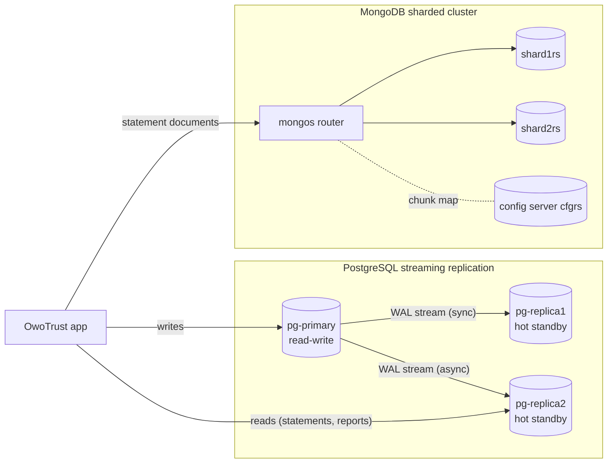
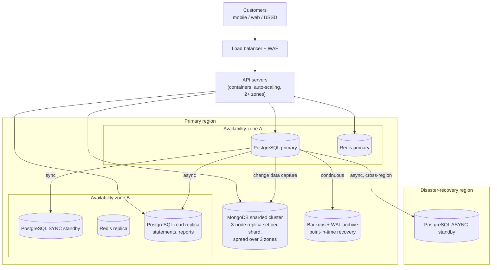

# Portfolio 5 – Distributed and Cloud Database Exercise

- **Case study:** OwoTrust Digital Bank (same schema and data as Portfolios 1–4)
- **Built locally with Docker:**
  - a PostgreSQL 16 **3-node replicated cluster**
  - a MongoDB 7.0 **sharded cluster** (config server + 2 shards + `mongos` router)
- **Designed:** the production cloud deployment (§5)

| File | Purpose |
|---|---|
| [docker-compose.cluster.yml](docker-compose.cluster.yml) | The 7-container distributed environment (separate Docker project `owotrust-dist`) |
| [postgres/primary-init.sh](postgres/primary-init.sh), [postgres/replica-entrypoint.sh](postgres/replica-entrypoint.sh) | Replication role, slots, and replica cloning with `pg_basebackup` |
| [postgres/01_replication_demo.sh](postgres/01_replication_demo.sh) | R1–R8: replication, stale reads, sync vs async, failure of the synchronous standby, quorum commit |
| [postgres/02_failover_test.sh](postgres/02_failover_test.sh) | F1–F6: kill the primary under live traffic, promote, measure RPO and RTO, re-point the other replica |
| [mongodb/](mongodb/) | Cluster initialisation; S1–S6: shard keys, distribution, query routing, a shard failure |
| [run_all.sh](run_all.sh) | Builds a fresh cluster and regenerates all `evidence/` (~3 min) |
| [evidence/](evidence/) | Captured output of every experiment |



---

## 1. Replication: [evidence/01_replication_demo.txt](evidence/01_replication_demo.txt)

**How it is built:**
- The primary writes every change to its **write-ahead log (WAL)** and streams the log to both replicas.
- Each replica was cloned with `pg_basebackup` and replays that WAL continuously as a read-only **hot standby**.
- A **replication slot** per replica makes the primary keep any WAL a replica has not yet received.

| # | Experiment | Result |
|---|---|---|
| R1 | Topology | `pg_stat_replication` shows both replicas `streaming`, and `pg_is_in_recovery()` = true on each |
| R2 | A deposit on the primary | Visible on replica1 and replica2 **about 2–5 ms later** (both replicas were polling before it was written) |
| R3 | Write to a replica | `ERROR: cannot execute INSERT in a read-only transaction` |
| R4 | **Stale read** (replay paused on replica2 to simulate lag) | The primary and replica1 show ₦520,000. **replica2 shows ₦450,000**, 528 bytes of WAL behind. After resuming: ₦520,000. *Asynchronous replicas are eventually consistent.* |
| R5 | `synchronous_standby_names = 'FIRST 1 (replica1)'` | replica1 becomes `sync`: a commit is confirmed only after replica1 has the WAL on disk |
| R6 | **The price of consistency** (3 interleaved rounds, median) | Async **2,967 tps / 2.70 ms**. Sync (remote flush) **2,431 tps / 3.29 ms (−18%)**. Sync (remote apply) **1,865 tps / 4.29 ms (−37%)**. Throughput falls as each commit waits for more confirmation, and that is on one laptop; between data centres every commit also pays the network round trip. |
| R7 | **The synchronous standby fails** | The next deposit **blocks**. The server shows the session waiting on `IPC / SyncRep`. After an operator cancel, the client gets *"canceling wait for synchronous replication … The transaction has already committed locally, but might not have been replicated."* **Consistency was chosen over availability.** |
| R8 | **Quorum commit** `ANY 1 (replica1, replica2)` | With replica1 still down, replica2 (`sync_state = quorum`) acknowledges and writes continue. When replica1 restarts, it **catches up on its own** from its slot. |

**Findings from R7 that I did not expect:**
1. **`statement_timeout` cannot end a synchronous-commit wait.** PostgreSQL switches the timer off just before COMMIT, and the wait happens *inside* COMMIT. The first version of this script relied on it and hung for **9 min 46 s**, until the waiting session was cancelled from another connection. In production this needs a watchdog, or a quorum configuration (R8) so that one failure cannot block writes.
2. **A cancelled commit is ambiguous.** The deposit *is* committed locally, but the client never received a confirmation. A safe retry is only possible with an idempotency key (Portfolio 3 D6, Portfolio 4 R4).

---

## 2. Failover under live traffic: [evidence/02_failover_test.txt](evidence/02_failover_test.txt)

A client posted deposits non-stop (`FO-000001`, `FO-000002`, …). It recorded each one **only after** the primary confirmed the commit. Then:

| Step | Result |
|---|---|
| F3: `docker kill --signal=SIGKILL` on the primary mid-write | The client's next write fails with *connection refused*. **234 deposits had been confirmed.** |
| F4: `pg_promote()` on replica1 (the synchronous standby) | Promoted and accepting deposits **1.8 s after the crash (RTO)**. A new **timeline (2)** begins, so WAL from after the failover can never be confused with the old primary's. |
| F5: **RPO check:** every confirmed deposit on the new primary? | **234 confirmed, 234 present, 0 LOST (RPO = 0)**. The stored balances still match the transaction history. |
| F6: re-point replica2 to the new primary | Slot created on replica1, `primary_conninfo` changed and reloaded. replica2 follows timeline 2 and receives new deposits. |

**What the 1.8 s does not include:** detecting the failure. Here the script promoted immediately. A real cluster manager (e.g. **Patroni** with etcd) needs roughly 10–30 s of missed heartbeats before it decides the primary is dead. The old primary also cannot simply be restarted: it must be resynchronised with `pg_rewind` or re-cloned.

**Why RPO = 0 depends on R5:** with only asynchronous replicas, deposits confirmed in the last milliseconds before a crash could be lost. On this laptop, async replica2 also had all 234, because the lag was about 2 ms. Across a slow network it would not.

---

## 3. Sharding (horizontal partitioning): [evidence/03_sharding_demo.txt](evidence/03_sharding_demo.txt)

The 132,386 monthly statement documents from Portfolio 4 were loaded **twice**, with two different shard keys, to compare them on the same data:

| Test | `{ accountNumber: "hashed" }` | `{ month: 1 }` (range) |
|---|---|---|
| S1: data distribution | **49.9% / 50.1%** | 33.0% / 67.0% (only 3 distinct months, so at most 3 chunks) |
| S2: "statements of account 3100000100" | **SINGLE_SHARD**: 1 shard asked, 3 documents examined | SHARD_MERGE: both shards asked, **132,386 documents examined** to return 3 |
| S2: "all statements for October" | SHARD_MERGE: both shards, 44,633 returned | **SINGLE_SHARD**: one shard |
| S4/S5: where 2,000 **new** November documents went | **992 / 1,008**, shared evenly | **0 / 2,000: every new write on one shard** |

**Choosing the shard key.** No key is best for every query. For OwoTrust:
- The dominant access path is *"this customer's statements"*, which the hashed account number routes to **one** shard.
- It also spreads new writes evenly, so adding shards really adds write capacity.
- The month key is a classic **monotonic, low-cardinality** mistake: every new month lands in the last range, on one shard (a hot spot), which no number of extra shards relieves.
- A compound key `{ accountNumber: "hashed", month: 1 }` would keep the even spread and still route "account + month" to one shard.

**S3, distributed aggregation:** October debits by channel. Each shard computes a partial `$group` and `mongos` merges them (`splitPipeline: true, mergeType: mongos`). The totals are **identical** to Portfolio 4's MongoDB and PostgreSQL results (e.g. ATM 4,205 debits / ₦106,165,580).

**S6, one shard offline:**
- Customers whose data is on the surviving shard are **unaffected**.
- A query needing the stopped shard fails with *"Could not find host matching read preference … shard2rs"*.
- With `allowPartialResults: true` the application can choose an **incomplete** answer: 22,325 of 44,633 statements, `partialResultsReturned = true`.

This is why production shards are **3-member replica sets**: a failed node triggers an automatic election, so the shard stays available. Sharding adds capacity; replication adds availability, and a bank needs both.

---

## 4. Consistency vs availability: CAP and PACELC applied to OwoTrust

**CAP:** when the network *partitions*, a system must give up either Consistency or Availability.
**PACELC** extends this: *Else*, when there is no partition, there is still a trade-off between **L**atency and **C**onsistency. R6 measured that trade-off directly.

| Component | Choice | Evidence | Justification |
|---|---|---|---|
| Ledger: transfers and balances (PostgreSQL primary + sync standby) | **PC/EC:** consistency first | R7: writes block rather than commit without the standby. R6: −18% throughput paid for RPO 0. F5: 0 deposits lost. | A confirmed transfer must never disappear. Brief unavailability is acceptable; lost money is not. |
| Balance shown in the app (async read replica) | **PA/EL:** available, possibly stale | R4: replica2 showed ₦70,000 less for a moment | Acceptable for display, **never** for authorising a debit. `transfer_funds()` always reads the primary. |
| Customer 360 and statements (MongoDB, sharded) | **PA/EL** with `w: majority` writes | S6: a failed shard affects only its own customers | It is a read model rebuilt from PostgreSQL, so stale-by-seconds is acceptable. |
| Sessions, OTP, rate limits (Redis) | **PA/EL** | Portfolio 4 R8: snapshots only | If lost, users log in again and limits reset briefly. |
| Fraud graph (Neo4j) | Batch / analytical | Portfolio 4 §4 | Rebuilt from PostgreSQL; minutes of staleness do not matter. |

---

## 5. Cloud deployment design

The local cluster shows the mechanisms; production needs them across **separate failure domains**. A single laptop cannot provide that, so this section is a design rather than a deployment.



### 5.1 Component choices

| Need | Managed-service option | Self-managed equivalent | Design decision |
|---|---|---|---|
| Ledger with automatic failover | AWS RDS for PostgreSQL **Multi-AZ** or Aurora PostgreSQL; Azure Database for PostgreSQL Flexible Server with **zone-redundant HA** | PostgreSQL + **Patroni** + etcd (what §1–2 do by hand) + PgBouncer | **Synchronous standby in a second zone** (as R5): zones are close, so the R6 latency cost stays small |
| Disaster recovery | Cross-region read replica | Async standby in a second region | **Asynchronous** across regions: a synchronous cross-region commit would add the full inter-region round trip to every transfer (R6) |
| Statement and profile store | MongoDB **Atlas** sharded cluster | MongoDB sharded cluster (§3) | Hashed `accountNumber` key; **3-member replica set per shard**, spread across zones |
| Sessions, OTP, limits | Amazon ElastiCache / Azure Cache for Redis, with a replica | Redis + Sentinel | Replica in a second zone, append-only file (AOF) enabled for rate-limit counters |
| Fraud graph | Neo4j AuraDB | Neo4j on a VM | Rebuilt nightly from PostgreSQL |
| Backups | Automated snapshots + **point-in-time recovery** | `pg_basebackup` + continuous WAL archiving (e.g. pgBackRest) | Restore is **tested** regularly, not assumed |

### 5.2 Recovery objectives

| Tier | RPO (data loss) | RTO (downtime) | Achieved by |
|---|---|---|---|
| Ledger, zone failure | **0** | < 2 min | Sync standby + automatic failover (§2 measured 1.8 s for promotion alone) |
| Ledger, region failure | Seconds | < 1 h | Async cross-region standby + runbook |
| Ledger, logical corruption (bad deployment, deleted data) | To the minute | Hours | **Point-in-time recovery**: replicas copy mistakes instantly, so only backups protect against them |
| MongoDB / Neo4j read models | Rebuildable | Minutes to hours | Re-export from PostgreSQL (Portfolio 4 pipeline: ~1 min for this dataset) |
| Redis | Seconds (acceptable) | Seconds | Replica promotion; users re-authenticate |

### 5.3 Location, security and compliance

- **Data residency.** The Nigeria Data Protection Act 2023 restricts transfers of personal data outside Nigeria unless adequate protection is in place, and banking regulators may expect customer data to be hosted locally. The nearest large public-cloud regions are in South Africa (for example AWS Cape Town, Azure South Africa North), while Lagos data-centre operators offer local hosting. A real deployment needs the compliance team to confirm where BVN, KYC and transaction data may be stored *before* a region is chosen. This could mean a **hybrid** design: ledger and PII in a Nigerian facility, stateless services in the cloud.
- **Security:**
  - encryption in transit (TLS between all nodes, including replication) and at rest (KMS-managed keys)
  - databases in private subnets with no public endpoints
  - separate roles: the `replicator` account cannot read application data
  - audit logging (Portfolio 3's `audit_log`, plus the cloud provider's audit trail)
  - secrets in a vault, not in files like this repository's development passwords
- **Cost drivers:**
  - the synchronous standby doubles database compute, but buys RPO = 0
  - cross-region replication adds data-transfer charges
  - sharding adds operational complexity, so it is justified only once a single replica set can no longer handle the write volume

---

## 6. How to run

```bash
# from the repository root, with Docker Desktop running
# (requires Portfolio 4's export: run ./portfolio-4-nosql/run_all.sh once beforehand)
./portfolio-5-distributed-cloud/run_all.sh
```

The cluster stays up afterwards for exploration:
- `docker exec -it dist-pg-replica1 psql -U owotrust -d owotrust_bank` (after the failover test this is the **primary**)
- `docker exec -it dist-mongos mongosh owotrust`, then `sh.status()`

To remove the cluster and its volumes:

```bash
docker compose -f portfolio-5-distributed-cloud/docker-compose.cluster.yml down -v
```
